<p align="center">
  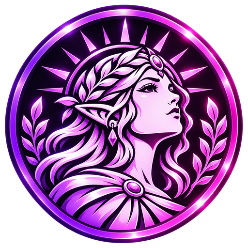
</p>

<h1 align="center">Nimcale</h1>

<p align="center">
  <b>Transforme uma imagem + mapa de altura em um relevo 3D pronto para imprimir:</b><br>
  moedas, medalhas, placas, azulejos, recortes e agora também <b>sobre objetos 3D</b> (copos, canecas, vasos...)<br>
  — com exportação HD fechada (watertight) para Windows e Linux.
</p>

<p align="center">
  <a href="https://github.com/cleitinhodev/nimcale/releases/latest"></a>
  <a href="https://github.com/cleitinhodev/nimcale/releases"></a>
  <a href="https://github.com/cleitinhodev/nimcale/actions/workflows/build.yml"></a>
  <a href="LICENSE"></a>
  
</p>

<p align="center">
  <a href="https://www.bugzinho.com/">Site</a> ·
  <a href="https://github.com/cleitinhodev/nimcale">Projeto</a> ·
  <a href="https://www.bugzinho.com/donate">Doar 💜</a> ·
  <a href="#english">English</a>
</p>

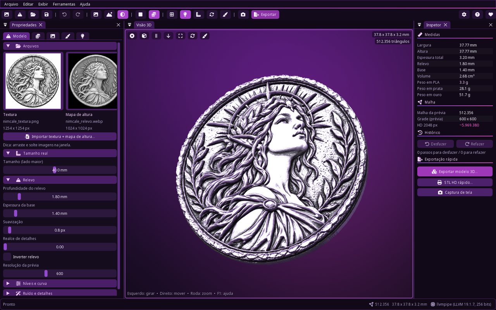

## ✨ Recursos

- **Relevo a partir de imagens** — textura colorida + mapa de altura (branco = alto, preto = baixo).
  Profundidade, espessura da base, suavização, limiar, brilho, contraste, níveis, curva de altura (gama),
  inverter, ruído e realce de detalhes.
- **Formas** — placa inteira ou **recorte do objeto**; contornos: contorno da imagem, círculo, elipse,
  retângulo arredondado, hexágono, octógono; **borda** (aro de moeda) e **chanfro**.
  Predefinições: moeda, medalha, placa, contorno, azulejo.
- **Recorte automático** — ao importar uma imagem nova o contorno segue o objeto (não fica redondo):
  fundo escuro, branco, transparente ou uma cor escolhida é detectado sozinho; o contorno pode vir do mapa
  de altura, da transparência ou da cor da textura. Ajuste fino: limiar/tolerância, expandir/encolher,
  suavizar, maciez da borda, preencher buracos, remover ilhas pequenas, manter só o maior objeto e
  **prévia do contorno** ao vivo.
- **Textura** — ajuste (esticar/conter/preencher), escala, deslocamento, rotação e **alinhamento automático**;
  visualização textura / altura / **mistura**; salvar e carregar alinhamento (compatível com o placa3d).
- **Superfície (objetos 3D)** — nova aba **Superfície**: importe um modelo 3D (OBJ+MTL, STL, PLY, GLB/glTF,
  3MF, OFF ou DAE) ou escolha um dos **12 modelos de exemplo** e a textura **e** o relevo são aplicados sobre
  ele — por exemplo, a imagem cobre um copo inteiro. Projeções automática, UV do modelo, cilíndrica, esférica,
  plana, caixa e decalque; mover, escalar, proporção X/Y separada, girar, emenda, repetir, espelhar;
  **exportação tudo mesclado** em um único modelo (também em HD) e **"Remover superfície / voltar à placa
  padrão"** com um clique.
- **Modelagem** — pincéis de escultura (elevar, rebaixar, suavizar, aplainar, apagar), **desfazer/refazer**,
  espelhar, girar 90°, recortar, medidas reais em **mm** (volume e peso em PLA/prata/ouro), cotas, grade, giro automático.
- **Exportação** — STL (binário/ASCII), OBJ + MTL + textura, GLB / glTF, PLY com cores, **3MF**, OFF,
  mapa de altura PNG 16 bits, normal map, textura PNG, **GIF** girando e capturas de tela HD / transparentes.
- **Exportação HD** — malha densa independente da prévia (até 6144 amostras no lado maior, milhões de
  triângulos), reamostragem bicúbica, progresso com cancelamento, **sólido fechado verificado** e simplificação adaptativa opcional.
- **Projetos** `.nimcale`, arquivos recentes, **arrastar e soltar** imagens.
- **Interface** moderna (Dear ImGui com docking): menus, barra de ferramentas, abas, inspetor, barra de status,
  tema roxo/rosa com **neon e gradientes animados** (podem ser desligados) e **barra de título que acompanha
  o tema claro/escuro do sistema** (ou escura / clara / cor do tema).
- **12 idiomas** com detecção automática: Português (Brasil), English, Español, Français, Deutsch, Italiano,
  Русский, Polski, Türkçe, 简体中文, 日本語, 한국어.
- **Compatibilidade máxima** — OpenGL 3.3; se o driver de vídeo falhar, o Nimcale usa automaticamente o
  renderizador por software **Mesa llvmpipe** incluído (funciona até em PCs/VMs sem GPU).

| | | |
|---|---|---|
| 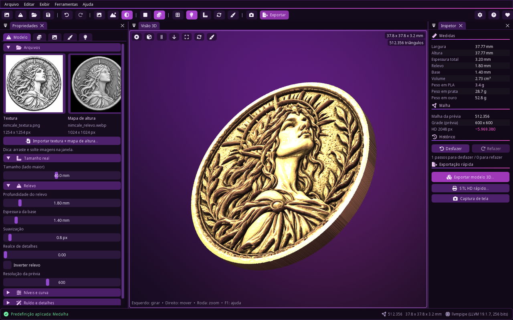 | 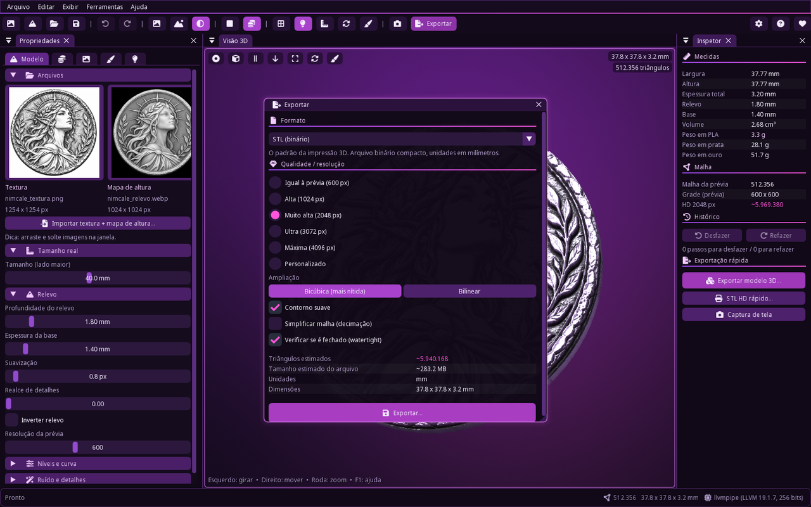 | 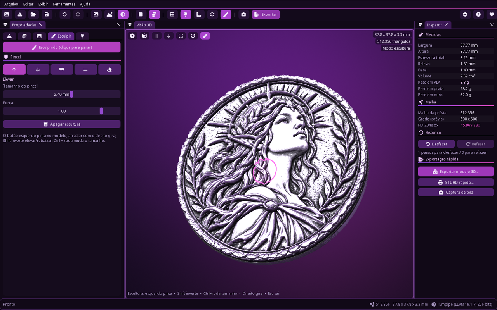 |
| 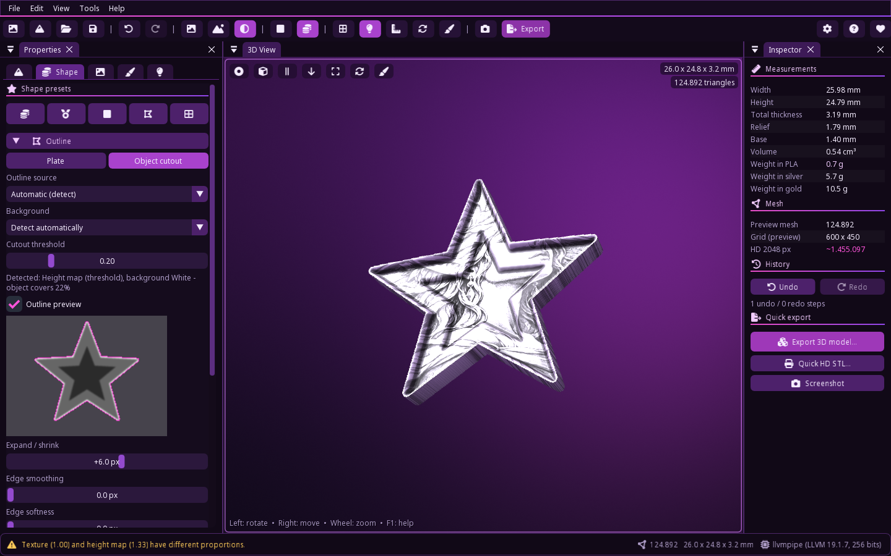 | 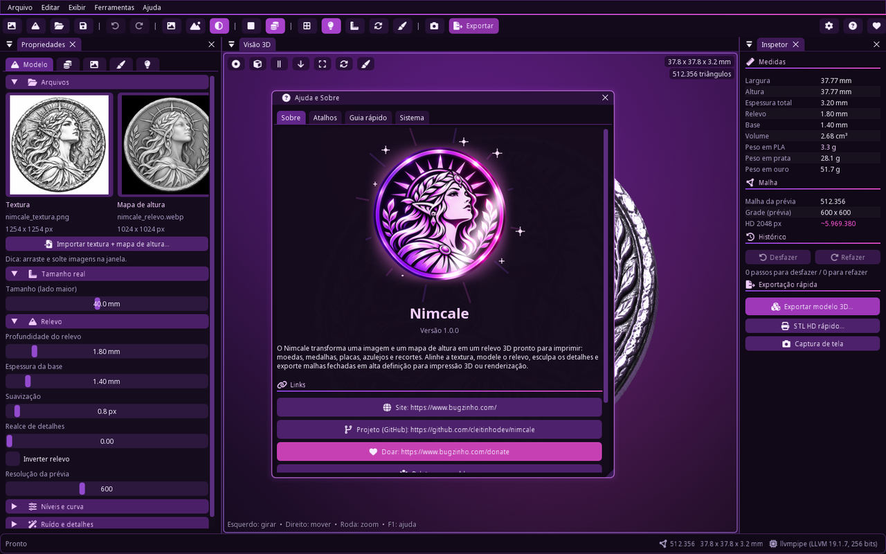 | 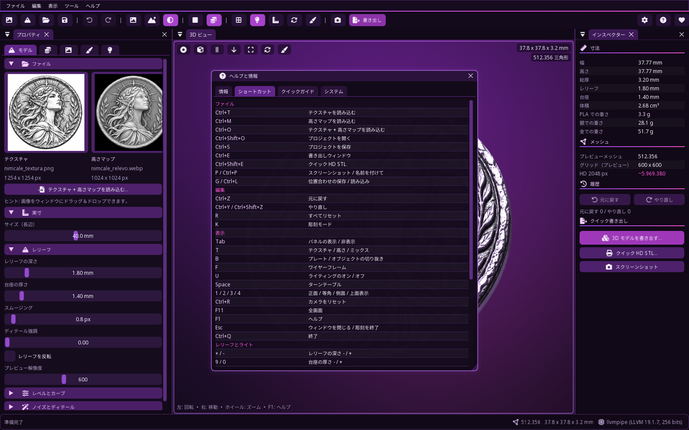 |

## 🧊 Superfície: relevo sobre objetos 3D (novo na 1.1)

Além das camadas de **textura** e **relevo**, a aba **Superfície** coloca a textura e o relevo da placa sobre
um objeto 3D. Nada foi removido: ao abrir, o Nimcale continua com a moeda padrão e a superfície é um extra.

1. Abra a aba **Superfície** (ou *Arquivo → Importar superfície*, `Ctrl+Shift+U`, ou arraste o arquivo 3D
   para a janela) e importe um modelo — ou clique em um dos **Modelos de exemplo**.
2. A projeção é escolhida sozinha (cilindro para copos e garrafas, esfera, objeto plano, caixa) e a imagem
   cobre a lateral inteira. Ajuste à vontade: **mover**, **escala**, **proporção de largura/altura separadas**,
   rotação, posição da emenda, repetir (ladrilhar), espelhar, só a face externa / também topo e fundo,
   usar o contorno da placa como máscara.
3. O relevo usa a profundidade, inverter e suavização de sempre e desloca a superfície pelas normais com
   subdivisão adaptativa (controle de **detalhe**). O modelo pode ser girado, redimensionado (mm) e colorido.
4. **Exporte tudo mesclado** em um único modelo: STL, OBJ + MTL + textura, GLB/glTF, PLY, 3MF ou OFF, inclusive
   na **exportação HD** (até 4 milhões de triângulos). Se o modelo importado era fechado, o resultado também é.
5. Quer voltar? **Remover superfície / voltar à placa padrão** (botão vermelho na aba ou menu *Arquivo*) —
   pode desfazer com `Ctrl+Z`, e todos os ajustes da placa/moeda continuam como estavam.

| Formato | Importar superfície | | Modelos de exemplo |
|---|---|---|---|
| OBJ (+MTL), STL, PLY | ✅ | | copo, caneca com alça, garrafa, vaso, |
| GLB / glTF, 3MF, OFF | ✅ | | bola, caixa, lata, prato, chaveiro, |
| DAE (Collada) | ✅ | | placa tipo capinha, porta-canetas, |
| FBX | ❌ (converta para GLB/OBJ, ex.: no Blender) | | cúpula de luminária |

Modelos grandes (mais de 2 milhões de triângulos) são simplificados ao importar; vários objetos no mesmo
arquivo são unidos; metros são convertidos para mm; normais que faltam são calculadas.

| Caneca | Caixa (repetir) | Vaso |
|---|---|---|
| 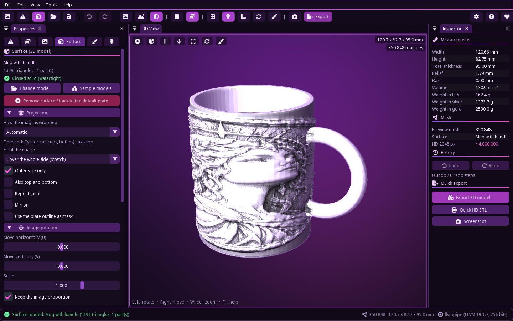 | 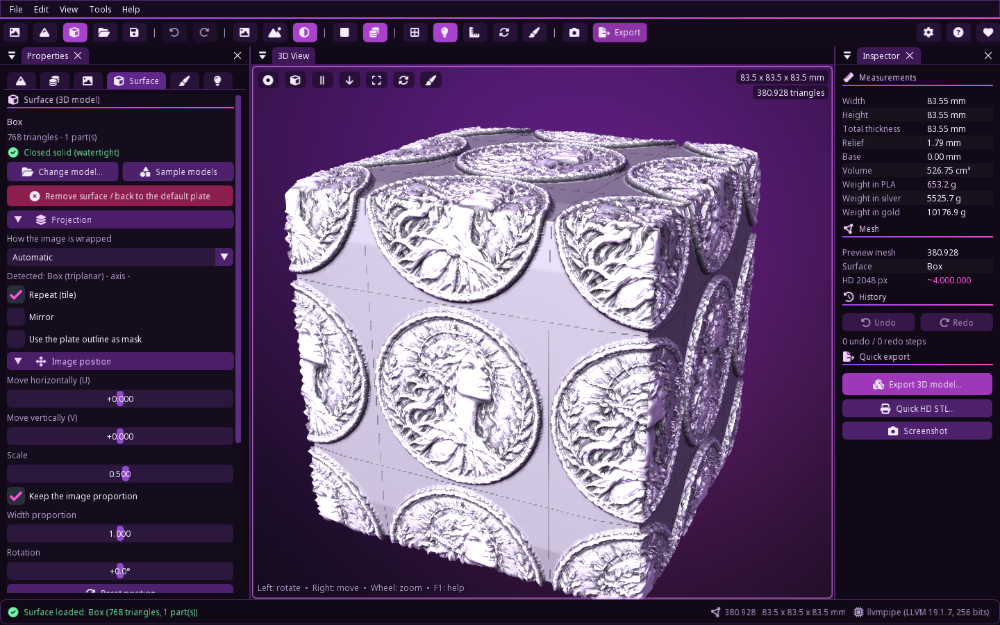 | 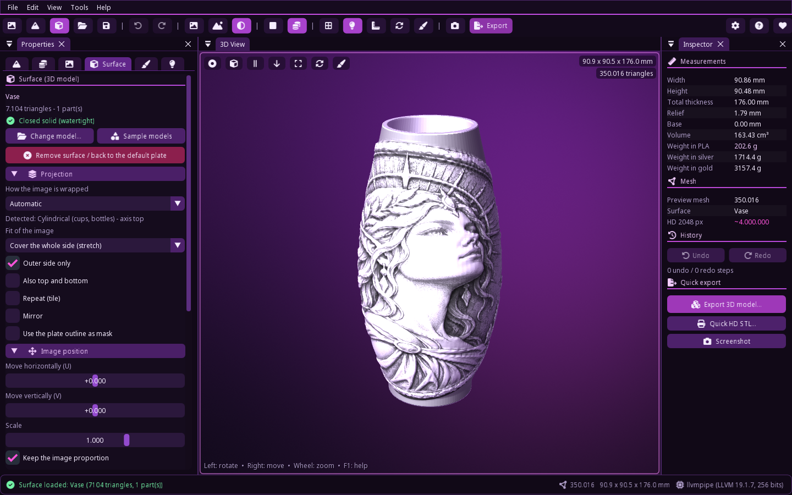 |
| 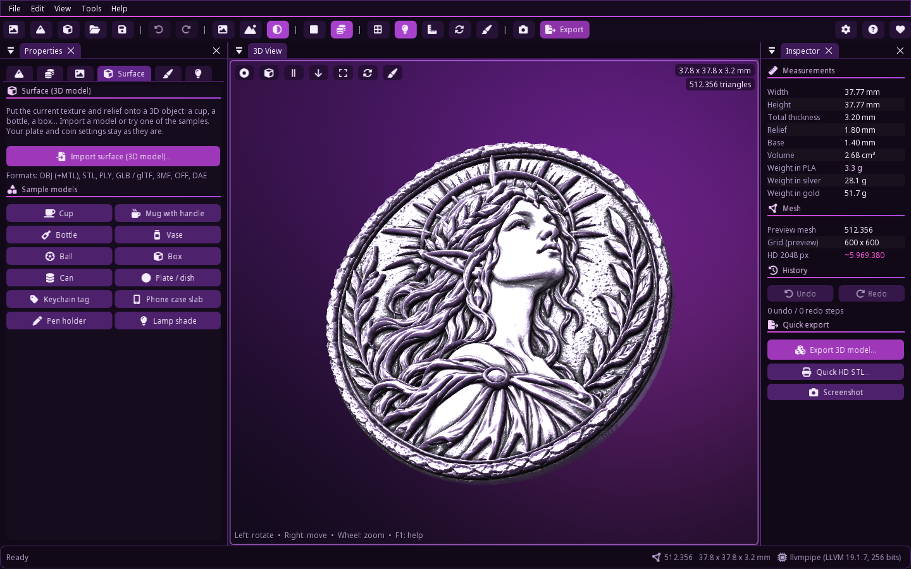 | 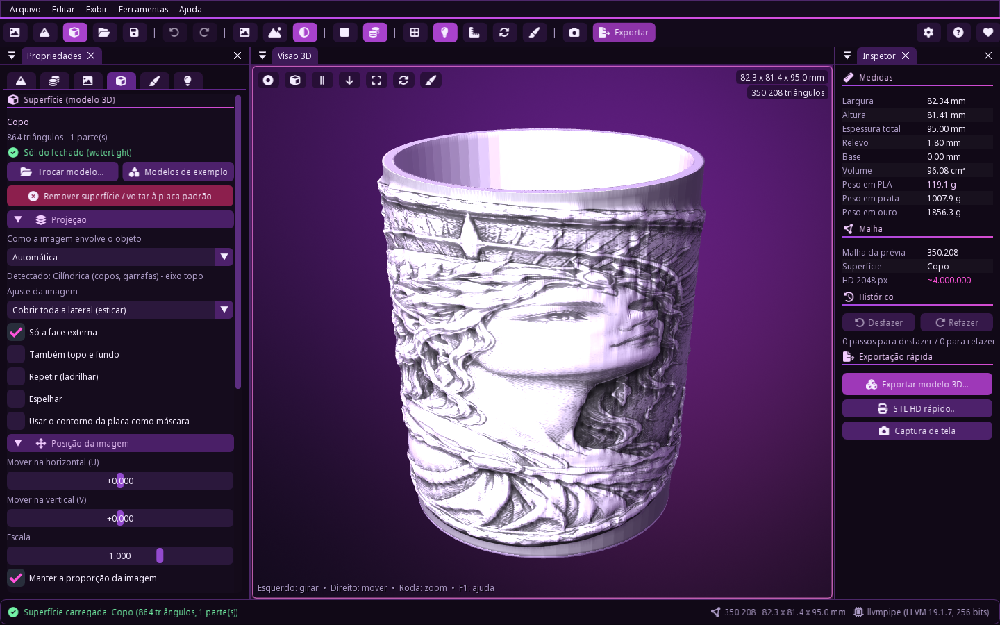 | 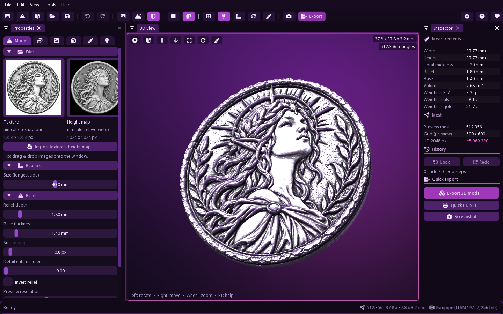 |

## 📥 Download

Tudo na **[versão estável mais recente](https://github.com/cleitinhodev/nimcale/releases/latest)** — não
precisa instalar nada. Versões de teste (marcadas como *pré-lançamento*) ficam em
[todas as versões](https://github.com/cleitinhodev/nimcale/releases).

### 🪟 Windows 10 / 11 (64 bits)

1. Baixe `Nimcale-<versão>-windows-x64.zip`.
2. Extraia a pasta e execute **`Nimcale.exe`**.

> O executável ainda não é assinado digitalmente: se o Windows SmartScreen avisar, clique em
> *Mais informações → Executar assim mesmo*. Sem placa de vídeo compatível, o Nimcale usa o Mesa
> llvmpipe incluído automaticamente.

Configurações e log: `%APPDATA%\Nimcale`. Exportações e capturas: `Documentos\Nimcale`.

### 🐧 Linux (x86_64)

Funciona em distribuições com **glibc 2.35 ou mais nova** (Ubuntu 22.04+, Linux Mint 21+, Debian 12+,
Fedora 36+, openSUSE Tumbleweed, Arch...) com OpenGL 3.3 (Mesa ou driver da NVIDIA/AMD/Intel), em X11 ou Wayland
(via XWayland). Há duas opções:

**AppImage (um arquivo só):**

```bash
chmod +x Nimcale-<versão>-x86_64.AppImage
./Nimcale-<versão>-x86_64.AppImage
```

> AppImage precisa do FUSE 2. Se aparecer *"dlopen(): error loading libfuse.so.2"*, instale `libfuse2`
> (Ubuntu 22.04: `sudo apt install libfuse2`; Ubuntu 24.04+: `sudo apt install libfuse2t64`) ou rode sem FUSE:
> `./Nimcale-<versão>-x86_64.AppImage --appimage-extract-and-run`.

**tar.gz (pasta):**

```bash
tar -xzf Nimcale-<versão>-linux-x86_64.tar.gz
cd Nimcale-<versão>-linux-x86_64
chmod +x Nimcale          # normalmente já vem executável
./Nimcale
./install.sh              # opcional: adiciona o Nimcale (com ícone) ao menu de aplicativos
                          # remover do menu: ./install.sh --uninstall
```

Pacotes do sistema (a maioria das distribuições com desktop já tem). Se faltar algo, no Ubuntu/Debian:

```bash
sudo apt install libgl1 libegl1 libgl1-mesa-dri libxrandr2 libxinerama1 libxcursor1 libxi6 libxkbcommon0
# opcionais: zenity (janelas de erro), xdg-utils (abrir links/pastas), x11-utils (barra de título escura)
```

Fedora: `sudo dnf install mesa-libGL mesa-libEGL mesa-dri-drivers libXrandr libXinerama libXcursor libXi`.
Sem driver de vídeo funcionando (VMs, servidores): `./Nimcale --software` usa o Mesa llvmpipe do sistema
(o Nimcale também troca sozinho se o driver falhar).

Configurações e log: `~/.config/Nimcale` (ou `$XDG_CONFIG_HOME/Nimcale`). Exportações e capturas:
`~/Documents/Nimcale` (ou `~/Nimcale`).

## ⌨️ Atalhos principais

| Tecla | Ação | Tecla | Ação |
|---|---|---|---|
| Ctrl+O | importar textura + mapa | Ctrl+Shift+O | abrir projeto |
| Ctrl+T / Ctrl+M | importar textura / mapa de altura | Ctrl+S / Ctrl+Shift+S | salvar projeto |
| Ctrl+E | janela de exportação | Ctrl+Shift+E | STL HD rápido |
| Ctrl+Shift+U | importar superfície (objeto 3D) | | |
| Ctrl+Z / Ctrl+Y | desfazer / refazer | Ctrl+Q | **sair** |
| T | textura / altura / mistura | B | placa / recorte do objeto |
| F | wireframe | U | iluminação |
| K | modo escultura | Espaço | giro automático |
| 1 2 3 4 | vistas frente / iso / lado / topo | Ctrl+R | redefinir câmera |
| + / − | profundidade do relevo | 9 / 0 | espessura da base |
| [ / ] | limiar do recorte | , / . | suavização |
| ← → ↑ ↓ | direção / elevação da luz | W A S D, Q/E, Z/X, C/V | mover / escalar textura |
| G / Ctrl+L | salvar / carregar alinhamento | P / Ctrl+P | captura / captura como |
| R | redefinir tudo | Tab | mostrar/ocultar painéis |
| F1 | ajuda | F11 | tela cheia |
| Esc | fechar janela / sair da escultura | Shift | ajuste fino |

Mouse: arrastar com o esquerdo gira, direito/meio move, roda dá zoom; no modo escultura o esquerdo pinta
(Shift inverte) e Ctrl+roda muda o tamanho do pincel.

> **Mudança em relação ao placa3d:** `Esc` não fecha mais o programa — use **Ctrl+Q**.

## 🛠️ Rodar a partir do código

```bash
git clone https://github.com/cleitinhodev/nimcale.git
cd nimcale
python -m venv .venv
# Windows: .venv\Scripts\activate    Linux: source .venv/bin/activate
pip install -r requirements.txt
python -m nimcale                       # moeda padrão
python -m nimcale textura.png altura.png
python -m nimcale projeto.nimcale
python -m nimcale --surface caneca.obj  # já abre com uma superfície (ou um exemplo: --surface mug)
```

Precisa do Python 3.10–3.13. No Linux, instale também os pacotes do sistema listados no download
(e `python3-venv` no Ubuntu/Debian).

Opções úteis: `--software` (força o renderizador Mesa), `--gpu`, `--lang en`, `--reset-layout`,
`--selftest`, `--shot arquivo.png` (captura de tela e sai), `--version`.

### Testes

```bash
pip install -r requirements-dev.txt
python -m pytest
```

Os testes cobrem o pipeline do relevo, malhas fechadas para todas as formas, todos os formatos de exportação
(verificados com `trimesh`), a exportação HD (milhões de triângulos, sólido fechado), o recorte automático,
a camada **Superfície** (importação dos 8 formatos, projeções, deslocamento, exportação mesclada fechada, HD,
remover/voltar à placa com desfazer), escultura, desfazer/refazer, idiomas completos e configurações.

### Gerar o executável do Windows

- **No Windows:** `.\scripts\build_windows.ps1` (precisa do Python 3.10–3.13 e do 7-Zip).
- **No Linux com Wine:** `scripts/build_wine.sh` (Python do Windows dentro do Wine, ver o script).

O build usa PyInstaller (`nimcale.spec`) e baixa o Mesa llvmpipe com `scripts/fetch_mesa.py`.

### Gerar o build do Linux

```bash
pip install -r requirements-dev.txt        # inclui o PyInstaller
python -m PyInstaller --noconfirm --clean nimcale.spec      # -> dist/Nimcale/Nimcale
scripts/package_linux.sh dist/Nimcale .    # -> Nimcale-<versão>-linux-x86_64.tar.gz (+ AppImage)
scripts/ci_smoke_linux.sh dist/Nimcale     # testes de fumaça (precisa de xvfb-run)
```

O AppImage é gerado se o `appimagetool` estiver no PATH (ou em `APPIMAGETOOL=/caminho`); para pular use
`--no-appimage`. Para rodar em distribuições mais antigas, compile na mais antiga que quiser suportar
(o CI usa Ubuntu 22.04). O Python precisa ter a biblioteca compartilhada (`libpython3.x.so`).

### GitHub Actions

Cada push compila e testa no **Windows** (`windows-latest`) e no **Linux** (`ubuntu-22.04`): testes
unitários, build com PyInstaller e testes de fumaça que **abrem o programa compilado** (Windows: probe do GPU,
Mesa, inicialização real, selftest; Linux: o mesmo sob `xvfb` com Mesa llvmpipe, mais uma captura da caneca
de exemplo e o AppImage). Ao publicar uma tag `v*`, o zip do Windows, o tar.gz e o AppImage do Linux são
anexados ao release.

## 📁 Estrutura

```
nimcale/
  core/      imagens, parâmetros, pipeline do relevo, formas, malha fechada, alinhamento, superfície 3D
  export/    escritores STL/OBJ/GLB/PLY/3MF/OFF/PNG e o trabalho de exportação HD
  tools/     histórico (desfazer/refazer) e escultura
  render/    câmera, shaders e renderizador moderngl
  ui/        tema, fontes, painéis, janelas, viewport, menus/barra de ferramentas
  i18n/      traduções (locales/*.json)
  assets/    ícones, fontes, moeda padrão, modelos de exemplo (samples/*.ply)
packaging/   Linux: nimcale.desktop e install.sh
scripts/     build (Windows/Linux), empacotamento, testes de fumaça, fontes, ícones, Mesa, exemplos, traduções
tests/       testes pytest
```

Para adicionar um idioma: copie `nimcale/i18n/locales/en.json`, traduza, registre o código em
`nimcale/i18n/__init__.py` e rode `python scripts/i18n_keys.py --check` (e `scripts/build_fonts.py`
se o idioma usar novos caracteres).

## 📜 Licença

Nimcale é software livre sob a **GNU General Public License v3.0 ou posterior** — veja [LICENSE](LICENSE).
Componentes de terceiros (Dear ImGui, Mesa, fontes Noto, Font Awesome…) estão listados em
[THIRD_PARTY_NOTICES.md](THIRD_PARTY_NOTICES.md).

Se o Nimcale foi útil, considere [apoiar o projeto](https://www.bugzinho.com/donate) 💜

---

<a id="english"></a>

## 🇺🇸 English

**Nimcale** turns an image and a height map into a printable 3D relief — coins, medals, plates, tiles and
cut-out shapes — and exports **watertight high-definition meshes**.

**Highlights**

- Relief controls: depth, base thickness, smoothing, threshold, brightness/contrast, levels, gamma curve,
  invert, noise and detail enhancement; cutout shapes (image outline, circle, ellipse, rounded rectangle,
  hexagon, octagon) with rim and bevel; presets (coin, medal, plate, contour, tile).
- **New in 1.1 — Surface tab:** put the texture **and** relief onto a 3D model. Import OBJ (+MTL), STL, PLY,
  GLB/glTF, 3MF, OFF or DAE (no FBX), or pick one of **12 sample models** (cup, mug with handle, bottle, vase,
  ball, box, can, plate, keychain tag, phone-case slab, pen holder, lamp shade). Automatic / UV / cylindrical /
  spherical / planar / box / decal projection; move, scale, separate X/Y proportion, rotation, seam, tile,
  mirror, outer wall only; displacement along the normals with adaptive subdivision; **merged export** of
  everything in one model (also HD, watertight when the input is closed); one-click, undoable
  **Remove surface / back to the default plate** that keeps every plate setting. Startup is still the default coin.
- Texture fit/scale/offset/rotation, **auto-align**, texture/height/**mix** views, alignment save/load.
- **Automatic cutout** that follows each imported image (dark / white / transparent / picked-colour background,
  height map, texture alpha or texture colour key) with fine tuning and a live outline preview.
- Sculpt brushes (raise, lower, smooth, flatten, erase), undo/redo, mirror, rotate, crop,
  real-world measurements in **mm** (volume, PLA/silver/gold weight), turntable.
- Export to STL (binary/ASCII), OBJ+MTL+texture, GLB/glTF, PLY with colours, **3MF**, OFF, 16-bit height map,
  normal map, texture PNG, turntable **GIF**, HD/transparent screenshots.
- **HD export** independent of the preview (up to 6144 samples on the longest side, millions of triangles),
  bicubic upsampling, progress + cancel, verified closed solid, optional adaptive decimation.
- `.nimcale` projects (surfaces included), recent files, drag & drop of images and 3D models.
- Modern docking UI with an animated purple/pink neon theme (can be disabled), a native title bar that follows
  the OS light/dark theme (or dark / light / theme colour), and **12 languages**
  with auto-detection (pt-BR default, English fallback).
- OpenGL 3.3 with automatic fallback to software rendering (bundled **Mesa llvmpipe** on Windows, the
  system Mesa on Linux).

**Download** from [the latest stable release](https://github.com/cleitinhodev/nimcale/releases/latest):

- **Windows 10/11 x64:** `Nimcale-<version>-windows-x64.zip` — extract and run `Nimcale.exe`
  (unsigned: on a SmartScreen warning click *More info → Run anyway*). Settings/log: `%APPDATA%\Nimcale`.
- **Linux x86_64** (glibc 2.35+: Ubuntu 22.04+, Mint 21+, Debian 12+, Fedora 36+...; OpenGL 3.3 via Mesa or
  the GPU vendor driver; X11 or Wayland through XWayland):
  - AppImage: `chmod +x Nimcale-<version>-x86_64.AppImage && ./Nimcale-<version>-x86_64.AppImage`
    (needs FUSE 2: `sudo apt install libfuse2` / `libfuse2t64` on Ubuntu 24.04+, or add `--appimage-extract-and-run`).
  - tar.gz: `tar -xzf Nimcale-<version>-linux-x86_64.tar.gz && cd Nimcale-<version>-linux-x86_64 && ./Nimcale`;
    `./install.sh` adds it with its icon to the application menu (`./install.sh --uninstall` removes it).
  - If libraries are missing (Ubuntu/Debian): `sudo apt install libgl1 libegl1 libgl1-mesa-dri libxrandr2
    libxinerama1 libxcursor1 libxi6 libxkbcommon0`. No working GPU driver: `./Nimcale --software`.
  - Settings/log: `~/.config/Nimcale`; exports: `~/Documents/Nimcale`.

**From source** (Python 3.10–3.13): `pip install -r requirements.txt` then
`python -m nimcale [texture heightmap | project.nimcale] [--surface model.obj|mug]`.
Tests: `pip install -r requirements-dev.txt && python -m pytest`.
Windows build: `scripts/build_windows.ps1`, `scripts/build_wine.sh` or GitHub Actions.
Linux build: `python -m PyInstaller --noconfirm --clean nimcale.spec && scripts/package_linux.sh dist/Nimcale .`
(tar.gz, plus an AppImage when `appimagetool` is available); smoke tests: `scripts/ci_smoke_linux.sh dist/Nimcale`.
CI builds and smoke-tests both (Windows on `windows-latest`, Linux on `ubuntu-22.04` under xvfb) and attaches
all packages to tagged releases.

**Note:** `Esc` no longer quits (it closes windows / leaves sculpt mode). Use **Ctrl+Q** to quit.

**License:** GPL-3.0-or-later. Third-party notices in [THIRD_PARTY_NOTICES.md](THIRD_PARTY_NOTICES.md).
Website: <https://www.bugzinho.com/> · Project: <https://github.com/cleitinhodev/nimcale> · Donate: <https://www.bugzinho.com/donate>
